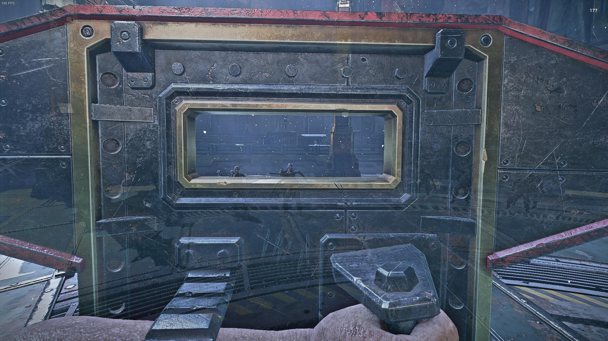
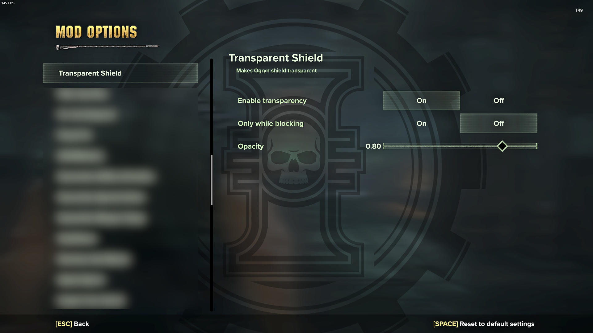

# Outdated
In v1.8.0 they changed the [FadeSystem](https://github.com/Aussiemon/Darktide-Source-Code/blob/master/scripts/extension_systems/fade/fade_system.lua), which I use to make weapons transparent, to work only with models which have [nodes](https://github.com/Aussiemon/Darktide-Source-Code/blob/master/scripts/extension_systems/fade/fade_system.lua#L54) (That's how I understood their code).  
I haven't found a way to make weapons work with it, therefore the mod is obsolete until they change it again or someone finds a solution.

# Transparent Shield mod for Warhammer 40,000: Darktide

[Official NexusMods page](https://www.nexusmods.com/warhammer40kdarktide/mods/439)

## Preview

